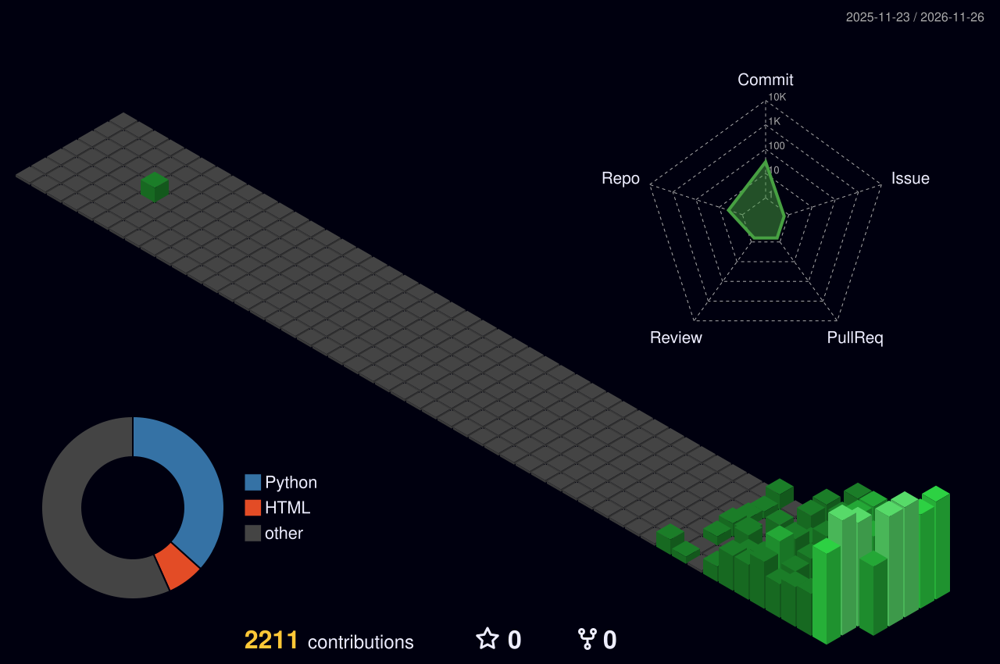

<p align="center">
  
</p>

<p align="center">
  <a href="https://github.com/RealRren">
    
  </a>
</p>

<p align="center">
  
  
</p>

---

<p align="center">
  
</p>

### `> ./player --status`

<p align="center">
  
</p>

---

```bash
root@realrren:~$ whoami
> RealRren — software developer building desktop apps, mobile apps, websites, games & Minecraft mods
> role ......... Lead @ Arcline Studios
> location ..... Sri Lanka 🇱🇰

root@realrren:~$ cat skills.txt
> [■■■■■■■■■■] Game Dev ........ Godot (GDScript) · Unreal Engine (C++)
> [■■■■■■■■■□] Minecraft Mods .. Forge 1.20.1 · Java 17 · server-side AI mods
> [■■■■■■■■■□] Mobile Apps ..... React Native · Expo · Supabase
> [■■■■■■■■■□] Desktop Apps .... Tauri (Rust + TS) · Electron
> [■■■■■■■■■□] Web Design ...... client websites · HTML/CSS/JS · Cloudflare Pages

root@realrren:~$ ls ./projects
> 🔒 [CLASSIFIED]  most projects are private & under active development
> 📦 nexora-engine  quotes, invoices & estimating tools for contractors (Windows, online/offline)
> ⛏️ adaptive-zombie-survival  Forge mod: zombies that break, dig & pillar up to reach you (MC 1.20.1)
> 🌐 pyromax-site  website for Pyromax Engineering, a fire engineering consultancy (launching Dec 2026)

root@realrren:~$ echo $STATUS
> currently compiling something big... stay tuned_
```

---

### `> ls ./focus_areas/`

<table align="center">
  <tr>
    <td align="center" width="25%">
      <h3>🎮</h3>
      <b><code>/game_dev</code></b><br/><br/>
      Godot · Unreal Engine<br/>
      Minecraft Forge<br/>
      GDScript · C++ · Java<br/><br/>
      <sub>gameplay systems, AI, survival &amp; zombie games, Minecraft mods</sub>
    </td>
    <td align="center" width="25%">
      <h3>📱</h3>
      <b><code>/mobile_apps</code></b><br/><br/>
      React Native · Expo<br/>
      TypeScript · Supabase<br/><br/>
      <sub>cross-platform apps for Android &amp; iOS</sub>
    </td>
    <td align="center" width="25%">
      <h3>🖥️</h3>
      <b><code>/desktop_apps</code></b><br/><br/>
      Tauri · Electron<br/>
      Rust · TypeScript · JS<br/><br/>
      <sub>fast native tools that work online &amp; offline</sub>
    </td>
    <td align="center" width="25%">
      <h3>🌐</h3>
      <b><code>/web_design</code></b><br/><br/>
      HTML · CSS · JS<br/>
      Cloudflare Pages<br/><br/>
      <sub>fast, responsive websites for businesses</sub>
    </td>
  </tr>
</table>

---

### `> tech_stack --list`

<p align="center">
  
  <br/>
  
  <br/>
  
</p>

<p align="center">
  
  
  
  
  
  
  
  
  
</p>

---

### `> cat ./featured_project.log`

<p align="center">
  <a href="https://github.com/RealRren/nexora-engine"></a>
  <a href="https://github.com/RealRren/nexora-engine-releases"></a>
</p>

<p align="center">
  <a href="https://github.com/RealRren/RealRren/tree/main/showcase"></a>
</p>

```diff
+ [ACTIVE]      Nexora Engine ........ contractor quoting & invoicing for Windows
+ [ACTIVE]      Mobile apps .......... React Native + Supabase
+ [ACTIVE]      Minecraft mods ....... Adaptive Zombie Survival (Forge 1.20.1)
+ [ACTIVE]      Client websites ...... Pyromax Engineering (launching Dec 2026)
+ [ACTIVE]      Games ................ Godot & Unreal projects in development
- [CLASSIFIED]  more coming soon...   access level insufficient 🔒
```

---

### `> system_stats --user RealRren`

<p align="center">
  
</p>

<p align="center">
  
</p>

<p align="center">
  
</p>

---

### `> ./trophies --unlock-all`

<p align="center">
  
</p>

---

### `> render --3d contributions.dat`

<p align="center">
  
</p>

---

### `> ./snake.exe --eat-contributions`

<p align="center">
  
</p>

---

<details>
<summary><b><code>> decrypt --file secret_dev_files.enc</code> 🔐 (click to decrypt)</b></summary>
<br/>

```yaml
decrypting... ████████████████ 100%

current_mission:  shipping apps from idea → release
favorite_combo:   Rust backend + TypeScript frontend (Tauri)
game_genres:      survival, zombies, systems-heavy gameplay
debug_method:     console.log() until it confesses
fuel:             ☕ coffee + 🎧 music
fun_fact:         most of my best work is still hidden in private repos 👀
motto:            "it works on my machine" → ships it anyway
```

</details>

---

### `> ./contact --open`

```bash
root@realrren:~$ ./contact --open
> status ....... 🟢 open for freelance work
> services ..... websites · mobile apps · desktop apps · games · Minecraft mods
> email ........ studiosarcline2@gmail.com
> reply ........ usually within 24h
```

<p align="center">
  <a href="mailto:studiosarcline2@gmail.com"></a>
  
</p>

---

<p align="center">
  
</p>

<p align="center">
  
</p>
