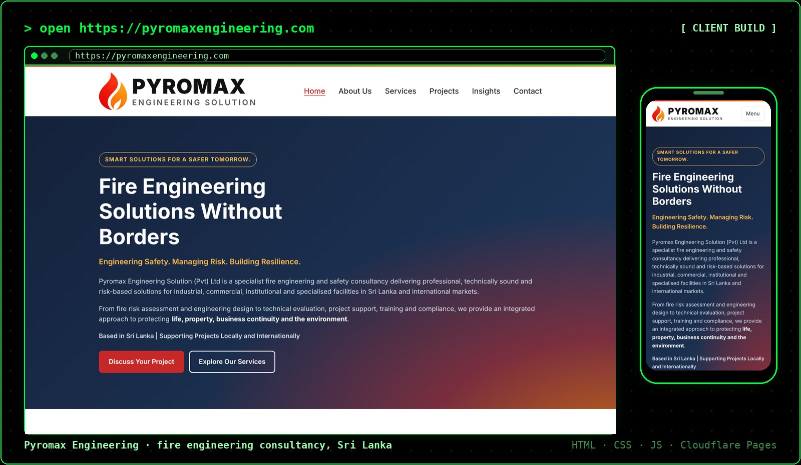
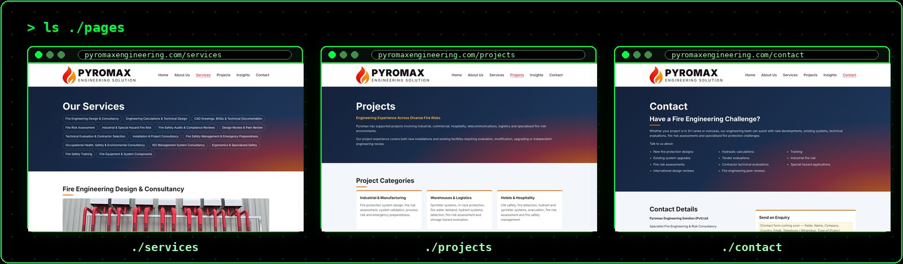

<p align="center">
  
</p>

```bash
root@realrren:~$ ls ./client_work
> 🌐 pyromax-engineering   fire engineering consultancy website   [ launching Dec 2026 ]
```

---

### `> ./showcase --client pyromax`

<p align="center">
  
</p>

```diff
+ client ....... Pyromax Engineering Solution (Pvt) Ltd · Sri Lanka
+ type ......... business website · 8 pages · desktop + mobile
+ built with ... hand-written HTML · CSS · JS (no frameworks, no build step)
+ hosting ...... Cloudflare Pages · custom domain · HTTPS + security headers
+ status ....... launching Dec 2026
```

<p align="center">
  
</p>

---

### `> ./contact --hire`

<p align="center">
  Need a website, app, game or Minecraft mod?<br/><br/>
  <a href="mailto:studiosarcline2@gmail.com"></a>
  <a href="https://github.com/RealRren"></a>
</p>
